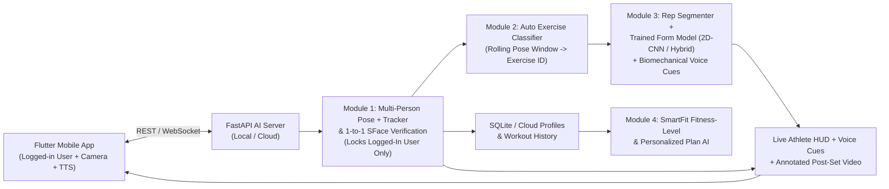

# AI Gym Trainer Mobile App — Graduation Project Scope & End-to-End Pipeline

## 1. Project Vision & Core Features
An AI-powered personal gym trainer mobile application (built with **Flutter** + **Python/FastAPI AI Backend**) that acts as a real-time and post-set workout coach using a standard smartphone camera:

1. **Real-Time Live Coaching & Post-Set Video Analysis**
   - Supports both live camera streaming during a workout and uploading a recorded set video afterward.
2. **Automatic Repetition Counting & Temporal Segmentation**
   - Tracks joint-angle trajectories to segment repetitions cleanly across camera angles.
3. **AI Exercise Form Quality Assessment**
   - Classifies every repetition as **Correct** or **Incorrect** using trained deep-learning and hybrid ML models evaluated strictly across unseen human subjects.
4. **Specific Real-Time Corrective Voice Cues (TTS)**
   - Delivers actionable spoken coaching feedback (e.g., *"Keep your back straight and chest up"*, *"Go deeper on your squat"*, *"Keep your hips level"*, *"Tuck your elbows in, don't flare them"*).
5. **Active-User Facial Recognition & Live Athlete HUD**
   - Recognizes registered users via **OpenCV YuNet + SFace (128-D cosine similarity)** and locks their identity onto their tracked person bounding box, displaying a live floating info card (**Name, Age, Height, Fitness Level**) even when the user turns sideways mid-exercise.
6. **Dynamic Fitness Level & Workout History**
   - Persists workout logs in SQLite (scaling to Firebase/Supabase) and updates the athlete's fitness level (`Beginner` / `Intermediate` / `Advanced`) from rolling form-quality scores.

---

## 2. Target Exercise Scope (Gym + Rehabilitation)
Selected for real-world gym & physical rehabilitation value, live-demo practicality, and direct multi-view dataset coverage:
1. **Bodyweight Squat** *(Mendeley 26 subj + REHAB24-6 9 subj = 35 subjects)*
2. **Standard Push-Up** *(Mendeley 26 subj + REHAB24-6 9 subj = 35 subjects)*
3. **Alternating Dumbbell Bicep Curl** *(Mendeley 26 subj)*
4. **Standing Dumbbell Shoulder Press** *(Mendeley 26 subj)*
5. **Bent-Over Dumbbell Row** *(Mendeley 26 subj)*
6. **Rehab Exercises (`REHAB24-6`):** **Leg Lunges**, **Arm Abduction (Lateral Raises)**, **Arm VW Shoulder Mobility**, **Leg Abduction**

**Explicit Out-of-Scope Boundaries:** Machine-heavy movements (Leg Press, Cable Flyes), Barbell Bench Press (heavy rack/plate joint occlusion), and high-velocity Olympic lifts (Snatch / Clean & Jerk).

---

## 3. End-to-End System Architecture (4-Module Hierarchical AI Pipeline)

1. **AI Module #1 — Logged-In User Lock-On (Multi-Person Gym Filtering):** Runs multi-person pose detection/tracking (`YOLO-Pose + ByteTrack` in production / `MediaPipe` in prototype) paired with **1-to-1 Face Verification (`OpenCV YuNet + SFace` 128-D cosine similarity)** against ONLY the logged-in user's enrolled embedding. Locks onto the logged-in athlete's Track ID so the HUD (`Name, Age, Height, Fitness Level`) stays solid through sideways turns and **ignores background gym-goers**.
2. **AI Module #2 — Automatic Exercise Recognition (Stage 1 Multi-Class Classifier):** Rolling 32-frame pose-window classifier trained across all Mendeley `kgbb3yn47p` + `REHAB24-6` exercises (+ `Idle/Rest`) so the app automatically recognizes which exercise the logged-in user is performing without manual menu selection.
3. **AI Module #3 — Repetition Counting, Form Quality & Specific Voice Cues (Stage 2):** Routes each rep to the exercise-specific trained form model (10-model benchmark: `2D CNN`, `Two-Stream 2D-CNN + BiGRU`, `BiLSTM + Attention`, `TCN`, `XGBoost`, `LightGBM`, `SVM`, `RF`, `Ensemble`) + triggers real-time spoken fixes (`flutter_tts`).
4. **AI Module #4 — Athlete Fitness-Level & Plan Personalizer:** Trained on `Tomertg/SmartFit_Dataset` (5-model CV) to predict initial Fitness Level & target sets/reps at signup, then dynamically updated from live workout form scores.

---

## 4. Dataset Strategy & Justification

| Stage | Dataset | Scale & Diversity | Purpose |
|---|---|---|---|
| **Baseline Pilot** | **REHAB24-6** (`zenodo.org/records/13305826`) | 9 squat subjects, 180 labeled reps, 1 primary angle | Initial prototype benchmark. Revealed severe validation-vs-test ranking instability on small subject counts (only 2 subjects per val/test split), motivating subject-grouped CV and a larger multi-view gym dataset. |
| **Core Gym Training (Active)** | **Mendeley Multi-View Seven Fitness Exercises** (`10.17632/kgbb3yn47p.3`) | **26 subjects × 3 smartphone camera views** (front, side, diagonal) × 7 real gym exercises, `Good` / `Bad` labels | Primary training & cross-subject model comparison dataset. Combined with REHAB24-6 Squats yields **35 unique subjects**. |
| **Final Thesis Scale-Up** | **QEVD (`QEVD-Fit-Coach`)** & **Fitness-AQA** | 148+ exercises / real-world gym videos with fine-grained error & coaching labels | Phase 2 expansion to train multi-label specific error classifiers directly from video/pose data. |
| **User Profile Personalization (AI Module #3)** | **SmartFit (`Tomertg/SmartFit_Dataset`)** | Tabular athlete profiles (`Age, Height, Weight, BMI, Experience`) | Trains a dedicated Fitness-Level Predictor (5-model CV: RF, SVM, XGBoost, LightGBM, MLP) so newly registered users receive an AI-predicted initial Fitness Level & workout plan, kept strictly separate from pose form models to prevent synthetic noise. |

---

## 5. AI Feature Engineering, Model Suite & Merging Strategy

### Dual Pose Representations (Per Repetition, `T = 32` Steps)
1. **Spatial-Temporal 2D Skeleton Grid `(32, 12, 6)`** — 12 core body joints (`11–16, 23–28`) centered at mid-hip and normalized by torso length `(x, y, z)` + frame-to-frame velocities `(dx, dy, dz)`. Designed for **`2D CNN`** and **`Two-Stream 2D-CNN + BiGRU`**.
2. **Biomechanical Angle Sequence `(32, 14)`** — Scale-invariant world-landmark angles & tilts (`left/right elbow, shoulder, hip, knee`, `torso_tilt`, `shoulder_line_tilt`, `hip_line_tilt`, `normalized wrist heights`, `body_line`).
3. **Phase-Aware Tabular Vector** — Global stats (`mean, std, min, max, ROM`), 3-phase breakdown (descent / bottom / ascent), angular velocity stats, and left-right symmetry metrics.

### Training-Only Pose Augmentation (Zero Leakage)
Applied strictly inside each training fold:
- **Horizontal Mirror Flip** (swapping left/right joints and negating X coordinates/velocities)
- **Mild Landmark Jitter** (simulating real smartphone camera noise)

### 10-Model Cross-Subject Benchmark (`5-Fold StratifiedGroupKFold` by `person_id`)
| Family | Models Benchmarked |
|---|---|
| **Classical / Tabular** | `Random Forest`, `SVM (RBF)`, `XGBoost`, `LightGBM` |
| **Deep Learning (1D / 2D / RNN / TCN)** | `1D CNN`, **`2D CNN (Spatial-Temporal Skeleton)`**, `BiLSTM + Attention`, `TCN` |
| **Merged Architecture (Feature Fusion)** | **`Two-Stream 2D-CNN + BiGRU Hybrid`** (fuses 2D spatial-temporal skeleton features + biomechanical angle sequence) |
| **Merged Ensemble (Cross-Family)** | **`Soft-Voting Ensemble`** (out-of-fold weighted blend of Top Deep Model + Top Tabular Model) |

### Evaluation Protocol
Every model is evaluated strictly on **unseen participants** (out-of-fold) using:
- **Primary Metric:** `OOF Macro F1` & `Fold Macro F1 (Mean ± Std)`
- **Supporting Metrics:** `Accuracy`, `Balanced Accuracy`, `Incorrect Precision`, `Incorrect Recall`, `PR-AUC`, `ROC-AUC`, `Latency (ms/rep)`, `Model Size (KB)`, and `Confusion Matrices`

### Verified Colab Benchmark Results (`5-Fold StratifiedGroupKFold`)

#### A. Bodyweight & Barbell Squat (`Mendeley 26 subj + REHAB24-6 9 subj`)
| Rank | Model | Family | OOF Macro F1 | Fold F1 (Mean±Std) | Accuracy | ROC-AUC | PR-AUC | Latency (ms/rep) |
|---:|---|---|---:|---:|---:|---:|---:|---:|
| 1 | **Random Forest** | Tabular | **0.6656** | 0.663 ± 0.041 | 0.6791 | **0.7147** | **0.6727** | 53.38 |
| 2 | **LightGBM** | Tabular | 0.6607 | 0.659 ± 0.043 | 0.6693 | 0.7040 | 0.6506 | **1.15** |
| 3 | **XGBoost** | Tabular | 0.6455 | 0.643 ± 0.047 | 0.6542 | 0.6948 | 0.6445 | **0.45** |
| 4 | **BiLSTM + Attention** | Deep (RNN) | 0.6374 | 0.630 ± 0.033 | 0.6408 | 0.6846 | 0.6155 | 50.40 |
| 5 | **Ensemble (BiLSTM-Attn + RF)** | Merged Ensemble | 0.6370 | 0.631 ± 0.026 | 0.6435 | 0.7067 | 0.6578 | 103.78 |
| 6 | **TCN** | Deep (TCN) | 0.6330 | 0.622 ± 0.078 | 0.6346 | 0.6852 | 0.5823 | 37.66 |
| 7 | **Merged: 2D-CNN + BiGRU** | Merged Hybrid | 0.6322 | 0.617 ± 0.050 | 0.6417 | 0.6572 | 0.5759 | 41.83 |
| 8 | **SVM (RBF)** | Tabular | 0.6316 | 0.627 ± 0.055 | 0.6417 | 0.6807 | 0.6285 | 0.98 |
| 9 | **2D CNN (Skeleton)** | Deep (2D) | 0.6126 | 0.605 ± 0.067 | 0.6132 | 0.6407 | 0.5412 | 16.91 |
| 10 | **1D CNN** | Deep (1D) | 0.5749 | 0.551 ± 0.116 | 0.5758 | 0.6300 | 0.5681 | 13.23 |

#### B. Standard Push-Up (`Mendeley 26 subj + REHAB24-6 9 subj`)
| Rank | Model | Family | OOF Macro F1 | Fold F1 (Mean±Std) | Accuracy | ROC-AUC | PR-AUC | Latency (ms/rep) |
|---:|---|---|---:|---:|---:|---:|---:|---:|
| 1 | **Ensemble (Merged: 2D-CNN + BiGRU + RF)** | Merged Ensemble | **0.6606** | 0.660 ± 0.054 | **0.6669** | **0.7061** | 0.6198 | 84.69 |
| 2 | **Random Forest** | Tabular | 0.6444 | 0.643 ± 0.057 | 0.6483 | 0.7015 | 0.6338 | 39.49 |
| 3 | **XGBoost** | Tabular | 0.6419 | 0.642 ± 0.068 | 0.6447 | 0.6922 | 0.6173 | 12.05 |
| 4 | **Merged: 2D-CNN + BiGRU** | Merged Hybrid | 0.6384 | 0.638 ± 0.035 | 0.6497 | 0.6774 | 0.5990 | 45.20 |
| 5 | **LightGBM** | Tabular | 0.6346 | 0.633 ± 0.068 | 0.6383 | 0.6815 | 0.6104 | **1.78** |
| 6 | **BiLSTM + Attention** | Deep (RNN) | 0.6329 | 0.632 ± 0.030 | 0.6361 | 0.6745 | 0.5808 | 58.43 |
| 7 | **SVM (RBF)** | Tabular | 0.6292 | 0.629 ± 0.053 | 0.6361 | 0.6889 | **0.6378** | **1.05** |
| 8 | **1D CNN** | Deep (1D) | 0.6212 | 0.620 ± 0.050 | 0.6232 | 0.6652 | 0.5712 | 14.85 |
| 9 | **TCN** | Deep (TCN) | 0.5569 | 0.552 ± 0.042 | 0.5824 | 0.6157 | 0.5361 | 39.08 |
| 10 | **2D CNN (Skeleton)** | Deep (2D) | 0.4233 | 0.405 ± 0.098 | 0.4649 | 0.5842 | 0.5161 | 18.76 |

*Key takeaway:* On Push-Ups, combining the **Two-Stream 2D-CNN + BiGRU** deep hybrid with **Random Forest** (`Ensemble`) beat every single standalone model (`0.6606` Macro F1, `0.7061` ROC-AUC), while `LightGBM`/`XGBoost` deliver sub-`2 ms` real-time inference for mobile deployment.

---

## 6. Project Milestones & Deployment Roadmap

- **Milestone 1 (Tuesday — Working Demo, Pipeline & Scope):**
  - Clean 10-model Colab benchmark (`colab/GymForm_MultiModel_Benchmark_Colab.ipynb`) running on Mendeley `kgbb3yn47p` + REHAB24-6 with automated Google Drive caching and exported `squat` & `push` bundles installed in `backend/models/`.
  - Working local **FastAPI Backend** (`backend/`, launched via `START_SERVER.bat`) with real **YuNet + SFace Facial Recognition**, active-person box lock-on, Stage-1 Auto Exercise Detection, rep counting, trained form inference, specific voice cues, post-set annotated video output, and built-in live browser demo (`http://localhost:8000`).
  - Connected **FormCoach Flutter Mobile App** (`formcoach/` & `formcoach_connected.zip`) wired to the backend (`BackendPoseAnalyzer` + `flutter_tts` + Face ID enrollment + live skeleton overlay + annotated video review).
- **Milestone 2 (Final Defense):**
  - Train & benchmark all 5 target exercises on Mendeley + QEVD / Fitness-AQA.
  - Convert winning deep models to **on-device TFLite / ONNX Runtime Mobile** inside Flutter for offline low-latency gym use.
  - Add workout plan recommendations and longitudinal progress analytics dashboard.
